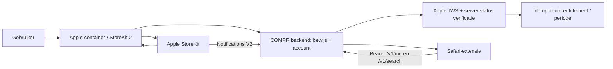

# StoreKit 2-architectuur — ontwerp, niet geïmplementeerd

De Safari-extensie is een niet-vertrouwde client. Een toekomstige native Apple-container start/restore't StoreKit 2-aankopen. De backend kent `pro` pas toe na cryptografisch geverifieerde Apple-transactie én veilige koppeling aan een geauthenticeerd COMPR-account. Safari gebruikt daarna gewone `/v1/me` en serverquota. Geen Stripe-dependency in dit pad.

| Onderdeel | Windows-prep | Mac/Xcode | Backend | App Store Connect | Test |
|---|---|---|---|---|---|
| Product | Voorstel `nl.getcompr.pro.monthly`; group `COMPR Pro`; internal ref `COMPR Pro Monthly`; visible name nog te lokaliseren | StoreKit 2 UI/bridge | Allowlist exact product-ID | Account Holder registreert pas later | Productload/geen product |
| Koop/restore | State/contract ontwerpen | `Product.purchase`, actuele entitlements/restore, veilige native-extensiecommunicatie onderzoeken; App Group alleen indien nodig | Geen vertrouwen op client-claim | Sandboxproduct configureren | Cancel/pending/success/restore |
| Verificatie | Testvectoren/contract | JWS veilig doorgeven, geen tokens loggen | Apple-certificaatketen/JWS, bundle, environment, product, signed dates, transaction ID en accountbinding valideren; App Store Server API indien nodig | API-toegang via bevoegde houder | Valid/invalid/replay/wrong app |
| Status | `pro` alleen server-side | UI leest `/v1/me` | Originele transaction ID uniek; expiry, grace, billing retry, refund, revoke, duplicate en out-of-order events; serverklok | Notifications V2 endpoint later configureren | Volgorde/expiry/refund |
| Cross-device | Accountidentiteit als sleutel | Restore op tweede toestel | Eén entitlement per bewezen COMPR-account; conflicten/quota atomair | N.v.t. | Twee apparaten/accountwissel |
| Offline | Geen Pro-belofte zonder bewijs | Toon gecachte status alleen als informatief | Auth-/entitlement-mutaties falen gesloten; geen providerzoekopdracht als quota onbekend | N.v.t. | Netwerk uit/terug |
| Privacy | Dataminimalisatie | Geen ruwe transactie in logs | Alleen noodzakelijke ids, product/status/tijden, beperkte retentie en toegangscontrole | Privacylabels herzien | Log-/deletionscan |

Notifications V2 vereisen een HTTPS-endpoint met ondertekende payloadvalidatie, idempotentie en Apple-statusreconciliatie; ze zijn geen bewijs wanneer een ongeverifieerde body aankomt. Bij gemiste notificaties moet een veilige statuscheck/reconciliatie bestaan. Sandbox en productie strikt scheiden. Geen generieke fail-open naar Pro. Apple bevestigt StoreKit 2 JWS en sandbox/TestFlight-gedrag: [StoreKit 2](https://developer.apple.com/storekit/), [Notifications V2](https://developer.apple.com/documentation/storekit/enabling-app-store-server-notifications), [TestFlight IAP](https://developer.apple.com/help/app-store-connect/test-a-beta-version/testing-subscriptions-and-in-app-purchases-in-testflight), geraadpleegd 2026-09-21.

De bestaande `entitlements`-tabel kent ook Stripe-afkomstige statusvelden; ontwerp een afzonderlijke Apple-bron/migratie en conflictregel zonder huidige gebruikers of Stripe-data te overschrijven. Geen backend- of migratiewijziging is nu uitgevoerd.
